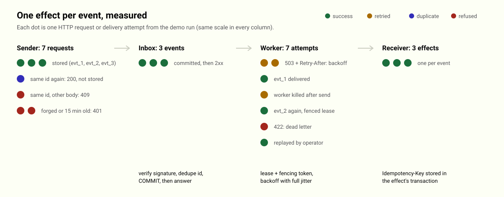

# Webhook Reliability Gateway

<picture>
  <source media="(prefers-color-scheme: dark)" srcset="docs/how-it-works-dark.svg">
  
</picture>

Use it when a provider sends webhooks at least once and your system must act on each event exactly once: a payment provider retries after a timeout, your service is down for a minute, or the process that forwards events dies at the worst moment. This stdlib-only Python project receives signed webhooks, stores each one once in SQLite before answering, and delivers it to your service with retries and an `Idempotency-Key`, so the effect happens once.

## Quickstart

```sh
python3 -m webhook_gateway demo
python3 -m unittest discover -s tests -v
```

The demo starts a real sender, the gateway and a receiver on 127.0.0.1, kills a worker process mid-delivery, and prints 10 measured steps, each with what it observed (exit code 1 if any fails):

```text
1. PASS  event accepted and committed before the answer
   HTTP 202, duplicate=False, committed rows 1
2. PASS  sender retries the same event after a timeout
   HTTP 200, duplicate=True
3. PASS  same id with a different body is refused
   HTTP 409
4. PASS  forged signature and 15-minute-old replay are refused
   HTTP 401 and HTTP 401
5. PASS  receiver down twice (503, Retry-After: 1): retried, then delivered
   attempts [503, 503, 200], waited 2.2 s
6. PASS  worker process dies after the receiver applied the event, before saving
   exit code 73, delivery state leased, receiver effects for evt_2: 1
7. PASS  lease expires, a new worker delivers again, receiver applies nothing twice
   attempts by ['crash-worker', 'worker-b'], effects for evt_2: 1
8. PASS  receiver rejects an event for good (422): dead-lettered after 1 attempt
   dead letters ['evt_3'], attempts [1]
9. PASS  operator fixes the receiver and replays the dead letter
   replayed=True, state delivered
10. PASS  each stored event changed the receiver exactly once
   3 events, 7 attempts, 3 effects
PASS
```

`demo --json` prints the full record: every request with its status, every delivery attempt with its worker and outcome, and the receiver's effects. The diagram above is counted from that record by `tools/build_diagram.py`, and a test fails when the committed SVGs no longer match a fresh run. No network access beyond 127.0.0.1 is used.

## Running it

```sh
export WEBHOOK_SECRET_SHOP='whsec_...'          # several values, space separated, during a rotation
python3 -m webhook_gateway serve --db gw.db --source shop=https://orders.internal/hooks
python3 -m webhook_gateway worker --db gw.db    # in another process; run several if you like
python3 -m webhook_gateway status --db gw.db
python3 -m webhook_gateway dead --db gw.db      # dead letters with their last error
python3 -m webhook_gateway replay --db gw.db 42
```

Providers post to `/hooks/<source>` with Standard Webhooks headers (`webhook-id`, `webhook-timestamp`, `webhook-signature: v1,<base64 HMAC-SHA256>`). Secrets come from the environment, never from the command line. `serve` binds to loopback; put a TLS-terminating proxy in front of it.

## What each part guarantees

| Part | Rule | Why |
| --- | --- | --- |
| Ingress | HMAC over `id.timestamp.body`, constant-time compare, timestamp within 300 s | a forged or captured request is refused before anything is stored |
| Ingress | answer 2xx only after SQLite COMMIT (`synchronous=FULL`, WAL) | an acknowledged event is never lost |
| Inbox | `UNIQUE(source, webhook id)`; same id with another body is 409 | provider retries are stored once; a reused id cannot change history |
| Worker | lease with a fencing token per attempt | a worker that dies is replaced after the lease; a stalled one cannot overwrite the newer result |
| Worker | 2xx done; 408, 425, 429, 5xx, network errors retried; other 4xx dead at once | a broken event does not burn the retry budget of a healthy queue |
| Worker | backoff with full jitter, capped; a `Retry-After` is a floor and the jitter goes on top of it | a recovering receiver is not hit by a synchronized wave, even when it told every event to wait the same time |
| Worker | expired leases count as attempts | a crash loop ends in the dead-letter list instead of looping forever |
| Receiver | stores `Idempotency-Key` in the same transaction as its effect | the at-least-once delivery becomes a once-only effect |

The last row is the receiver's job; `webhook_gateway/receiver.py` shows the pattern in 20 lines.

## Limits

- One SQLite file: fine for thousands of events a minute on one machine, not a multi-region queue.
- Delivery order is by due time, not strict per-key ordering.
- Targets are fixed per source by the operator; events cannot choose where they are sent, and redirects are not followed.
- Payloads up to 256 KB, JSON only.

## License

MIT
